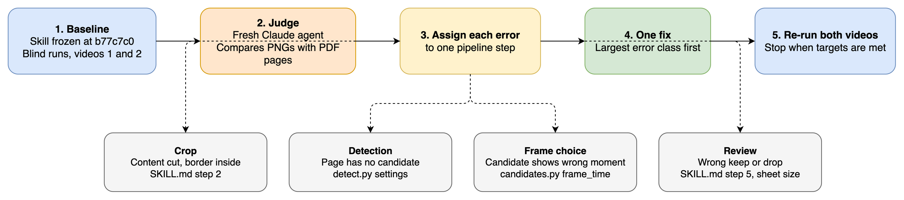

# Evaluate the video-slicer skill on two recordings

The skill was tuned on one recording. See "Open points" in the [skill design](../2026-11-09-video-slicer-skill/design.md). Two runs on that recording kept 30 and 31 PNGs, compared only with a manual count of about 34. See the notes in [task 06](../2026-11-09-video-slicer-skill/tasks/06-skill-workflow.md). This change measures the skill on two recordings against a reference for each, then improves it where the measurements show errors.

Skill under test: [`SKILL.md`](../../../.claude/skills/video-slicer/SKILL.md) at commit `b77c7c0`.

## Test data

Both videos and both reference PDFs are in `../music-transcriber/testdata/`, next to this repo. The folder is read-only for this work.

| | Video 1 | Video 2 |
|---|---|---|
| Video | `Tesena Fest 2025 ｜ Beyond Code： A Tester’s Approach to Pull Request Reviews ｜ Andrea Jensen.mp4` | `Meet-up OpenRewrite für Testcode-Modernisierung [...]-Besprechungsaufzeichnung.mp4` |
| Reference | `Beyond-Code-A-Testers-Approach-to-Pull-Request-Reviews_Andrea-Jensen_Tesena-Fest-2025.pdf` | `OpenRewrite-for-Test-Automation_Christian-Baumann_Summit-Community-Meetup-2026-06 (1).pdf` |
| Reference pages | 37 | 35 |
| Reference origin | Images of 1334x752, made with `img2pdf`, green slide border visible. Very probably cut from the recording. Origin not confirmed. | Original deck export |
| Recording | Conference, 44 min, 25 fps | Teams meeting, 49 min, 16 fps |
| Slide area | Left, inside a border | Left, participant tiles on the right |
| Other content | Full-screen speaker and audience cuts | Host slides, live demo, speaker view at the end |
| Segments at `-50dB`, `d=2` | 52 | 137 (rough crop `1592:892:0:108`) |

Detection and candidate extraction on video 2 took 32 s and 13 s.

### Findings in video 2

Segments per 5 minutes:

| Minute | 0 | 5 | 10 | 15 | 20 | 25 | 30 | 35 | 40 | 45 |
|---|---|---|---|---|---|---|---|---|---|---|
| Segments | 25 | 7 | 6 | 13 | 12 | 42 | 26 | 5 | 0 | 1 |

- Candidates #64 to #129 are IDE, terminal and browser frames: 66 of 137 candidates, or 48 %.
- 137 candidates give a contact sheet of 18 rows. The sheet was only tested with 52 candidates.
- 56 segments are shorter than 5 s.
- Host slides that are not in the deck come first, for example "Community Days" and "Organisation & Speaker".
- Slide builds occur, for example "Who is that guy?".
- Pages 23, 26 and 29 of the deck are the same "DEMO TIME" slide. The deck has 33 different slides.

### Conflicts between the video 1 reference and the skill rules

| Reference pages | Measured | Reference | `SKILL.md` step 5 |
|---|---|---|---|
| 34 to 37: Slido Q&A | PSNR 12 to 17 dB between neighbours | Kept | Dropped |
| 17 and 18: steps of one build | PSNR 14.6 dB | Both kept | Final state only |
| 19 to 22: two titles that alternate | PSNR about 13 dB between pages with the same title | All kept | The judge decides: repeat or different content |

## Evaluation loop

The loop finds the pipeline step that caused each error, so that each fix goes to the correct place.



Steps: baseline, judge, assign each error to one step, apply one fix, re-run both videos. Error classes: crop, detection, frame choice, review.

Each reference page with no PNG is classified in this order:

```text
for each reference page with no PNG:
  if a skill rule excludes it (Q&A, earlier build step, repeat): rule conflict
  elif a candidate shows the page: review error
  elif the video shows the page, near the neighbouring pages: detection error
  else: not shown
```

Each PNG with no reference page is classified as a host slide (no error) or an extra PNG (error). A candidate that shows a transition or the wrong moment of its segment is a frame choice error. Claude checks the crop separately on the PNGs.

## Result format

Each file in `results/` has one section per run:

```markdown
## Run 1

Crop: W:H:X:Y | Segments: N | Candidates: N | Exported: N
Crop check: pass or fail, with reason

| Reference page | Status | PNG or candidate | Error step |
|---|---|---|---|
| 5 | found | 0005_00-03-12.png | |
| 18 | rule conflict: build step | #21 | |
| 23 | review error | #40 | review |

| PNG with no reference page | Class |
|---|---|
| 0001_00-00-04.png | host slide or extra |

Totals: found, missed, not shown, rule conflict, extra
```

Status is one of `found`, `rule conflict: <rule>`, `review error`, `detection error`, `frame choice error`, `not shown`. `missed` in the totals is the sum of the three error statuses.

## Key Decisions

### Reference

- **Decision:** Use the PDF of each talk as the reference. Claude does the comparison.
- **Reason:** A reference that does not come from the skill's own review can show what the skill missed. No manual labelling is necessary.
- **Trade-offs:** Rejected hand labels (about 137 decisions on video 2). Rejected Claude checking its own review with no reference (same judge twice). The references say nothing about demo frames. The video 1 reference includes the border, so it cannot check the crop.

### Live demo frames

- **Decision:** Drop all IDE, terminal and browser frames. Add them to the drop list in `SKILL.md` step 5. This is the first fix.
- **Reason:** The output purpose is one PNG per slide, in most cases. A reference can verify only the slide content.
- **Trade-offs:** Demo content is lost. The final report still lists the dropped candidates. Rejected a selection of key screens (no reference for "key"), one marker frame per demo block (little content), and keeping all frames (66 near-identical frames).

### Baseline

- **Decision:** Freeze the skill at `b77c7c0`. Run it from a `git archive` export in a temp folder, blind on both videos, two runs per video. The export lets fixes start while the baseline runs.
- **Reason:** Crop and review are Claude's judgement and can vary between runs. Two runs help to separate a real gain from chance. Changing the skill first would hide what video 2 shows.
- **Trade-offs:** Four full skill runs cost more than two. Video 1 is not new data, because it was used for tuning.

### Output location

- **Decision:** Write the output and the work directory to a temp folder. Keep the work directory after each run.
- **Reason:** The default output is next to the video, which is in the read-only folder. The error analysis needs `candidates/` and `segments.json`.
- **Trade-offs:** Evaluation runs differ from the `SKILL.md` defaults in these two points.

### Judge

- **Decision:** A fresh Claude agent per run. It sees only the exported PNGs, the kept work directory and the PDF pages. It writes one table that maps reference pages to PNGs.
- **Reason:** The agent that ran the skill would be biased by its own decisions. The agents that run the skill do not see the PDFs.
- **Trade-offs:** Claude can still make matching errors. Visual comparison is necessary, because the deck for video 2 is a different rendering from the recording, which makes pixel metrics weak.

### Reference conflicts

- **Decision:** Keep the current rules: drop Q&A pages, keep only the final build step. Count these reference pages as "rule conflict", not as missed.
- **Reason:** The rules are decisions in the skill design. A reference made for another purpose does not overrule them.
- **Trade-offs:** The Slido pages hold real audience questions, and the skill does not export them.

### Pages not shown

- **Decision:** A reference page with no PNG is searched in all candidates, then in the video near its neighbouring pages. If it is absent, it is "not shown".
- **Reason:** A page in the deck was not always shown in the talk. Counting it as missed would give false errors.
- **Trade-offs:** The search near neighbouring pages needs extra frames.

### Targets

- **Decision:** No missed slide among the slides shown. At most 2 extra PNGs per video. The crop has no border inside and no content cut. Applies to each run.
- **Reason:** Each video has about 35 pages, so absolute counts are clearer than percentages.
- **Trade-offs:** The limit of 2 extra PNGs is a judgement.

### Change method

- **Decision:** One fix at a time, for the largest error class first. Re-run both videos after each fix. A fix must not make the other video worse.
- **Reason:** One fix per run shows which change had which effect.
- **Trade-offs:** More runs than one combined fix.

### Fixes only with evidence

- **Decision:** Change `detect.py` settings only if the baseline shows missed slides. For the contact sheet, first test whether 137 candidates cause review errors. If yes, make always reviewing in groups a `SKILL.md` change.
- **Reason:** Current defaults have a known reason. See "Detection settings" in the [skill design](../2026-11-09-video-slicer-skill/design.md).
- **Trade-offs:** Rejected a script that removes near-duplicates until the baseline shows the need.

### Results

- **Decision:** Record results in this change folder as a table per video and run. No permanent evaluation harness in the repo. Script changes get unit tests as usual.
- **Reason:** The videos are about 700 MB and are outside this repo, so an automated run is not possible in `uv run pytest`.
- **Trade-offs:** Each evaluation is a manual sequence of agent runs.

## Open points

- Both videos count as tuning data after this work. A general claim needs a third recording that was not used for tuning.
- The origin of the video 1 reference is an inference from its image size and format.
- Behaviour with a moving laser pointer or heavy compression stays unknown, unless one of the two videos shows it.
