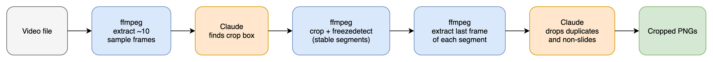
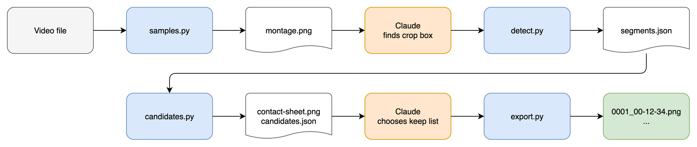

# video-slicer skill

A Claude Code skill. Input: a recording of a talk or lecture. Output: one cropped PNG for each relevant content change, usually one per slide.

Two problems need a solution:

- **Where to crop:** find the slide area. Exclude the speaker, the conference frame and logos.
- **What is a relevant change:** a new slide is relevant. Compression noise and speaker movement are not.

Visual comparison of the options: [diagrams/index.html](diagrams/index.html). Each PNG has its `.drawio` source next to it.

## Pipeline



Blue steps are ffmpeg, driven by the script. Orange steps are Claude.

## Evaluation

Tested with ffmpeg 9.0.2 on one real recording: 44 min, 1920x1080, 25 fps, slides left, speaker box and logo right, with cuts to full-screen speaker and audience shots. Crop: `1320:740:100:170`.

One run of three `freezedetect` passes over the whole recording took 91 s.

| `n` (`d=2`) | Segments | Result |
|---|---|---|
| `-30dB` | 77 | Merged five dark "Elements" slides into two segments, so three of them are lost. Many stable segments on full-screen speaker and audience shots. |
| `-40dB` | 69 | Counted only. Frames not inspected. |
| **`-50dB`** | **52** | All slides found at `-30dB` also present, and the five "Elements" slides separate. 10 frames with no slide content, 8 repeats of a slide. About 34 frames remain after review (manual count). |

Other filters, tested on a synthetic 30 s video with a small bullet appearing and noise on all frames:

| Filter | Result |
|---|---|
| `select=scene` | Slide change scores 1.0. Small bullet scores 0.017, the same as noise at 0.018. Small changes are lost. |
| `cropdetect` | Returns the full frame. It cannot find a slide area. |

The likely cause of repeats is a camera cut that interrupts one slide, which gives two or more stable segments. This is not confirmed.

## Key Decisions

### Division of work

- **Decision:** ffmpeg does the pixel comparison. Claude finds the crop box and reviews the candidates.
- **Reason:** Claude reading each frame at 1 fps costs about 3.3M image tokens for a 45-minute talk at 720p. Claude needs only about 10 sample frames and one contact sheet.
- **Trade-offs:** Rejected Claude reading every frame (cost). Rejected a script-only solution (`cropdetect` cannot find the slide area).

### Change detection

- **Decision:** Run `crop` + `freezedetect` directly on the video. Each stable segment is one candidate.
- **Reason:** It found small changes that scene scores lost. No frame export and no custom diff code are necessary.
- **Trade-offs:** Replaces the first idea of a 1 fps PNG export with a comparison. A slide visible for less than `d` (2 s) is not found.

### Detection settings

- **Decision:** Defaults `n=-50dB`, `d=2`, as named constants.
- **Reason:** Best result on the real recording. `-30dB` merged slides.
- **Trade-offs:** Tuned on one recording. Other recordings can need different values, so the script accepts overrides.

### Crop box

- **Decision:** Claude reads a montage of 10 to 12 evenly spaced frames, then a 4x magnification of the slide corners. The box is inside any slide border.
- **Reason:** On the real recording, this gave a box of 1322x741 inside the border, which is 16:9 as expected for a slide.
- **Trade-offs:** Presenter icons and the mouse pointer inside the slide area stay in the image.

### Frame to keep

- **Decision:** Take the frame 0.5 s before each segment ends. The last segment can have no `freeze_end`, so use the video duration.
- **Reason:** The frame shows the final state of the segment and is before the next transition.
- **Trade-offs:** Rejected the first frame, which can catch a transition.

### Candidate review

- **Decision:** Claude reads one contact sheet of all candidates. Claude drops frames with no slide, repeats, and earlier steps of a slide build. Only the final state of a build stays.
- **Reason:** A sheet of 52 candidates costs about 3k image tokens. It was sufficient to classify the real recording.
- **Trade-offs:** Slide-build steps are lost by choice. Rejected keeping each step (near-duplicates). Small text differences can need a look at the full-size frames.

### Contact sheet labels

- **Decision:** Build the sheet with the ffmpeg `tile` filter. The script prints the mapping from grid position to candidate number and timestamp.
- **Reason:** The installed ffmpeg has no `drawtext` filter, and the script uses the standard library only.
- **Trade-offs:** Claude must count grid positions, with no number printed on the frames.

### Layout changes

- **Decision:** One crop box per video. Claude warns when samples show other slide layouts.
- **Reason:** It was sufficient for the real recording. Full-screen cuts have no slide and are dropped in review.
- **Trade-offs:** Rejected one crop box per time range until a real video needs it.

### Packaging

- **Decision:** `.claude/skills/video-slicer/SKILL.md` and four small scripts plus a shared `media.py` in `.claude/skills/video-slicer/scripts/`, standard library only, tested with pytest. `SKILL.md` holds the judgement steps. The scripts hold the ffmpeg calls and output parsing.
- **Reason:** Parsing `freezedetect` output and computing timestamps are pure functions and can have unit tests. Separate scripts that share only files on disk let implementation tasks run in parallel with no file overlap.
- **Trade-offs:** `SKILL.md` runs a longer sequence of commands than one `slice.py` would need. Rejected a shell script (hard to test) and an installed package (not necessary).

### Output

- **Decision:** `<video>-slices/0001_00-12-34.png` next to the video, at full crop resolution.
- **Reason:** The name gives order and position in the talk. The timestamp is the segment start, which is the moment the slide appears.
- **Trade-offs:** Rejected a JSON index (no use case yet).

### OCR

- **Decision:** Do not use Tesseract in v1.
- **Reason:** Claude already reads the candidates.
- **Trade-offs:** No searchable text output.

## File structure and interfaces



Task split: [diagrams/tasks.html](diagrams/tasks.html).

```text
.claude/skills/video-slicer/
├── SKILL.md            # judgement steps and command sequence
└── scripts/
    ├── media.py        # ffmpeg and ffprobe wrappers, typed errors
    ├── samples.py      # sample frames and montage
    ├── detect.py       # crop + freezedetect, writes segments.json
    ├── candidates.py   # candidate frames, contact sheet, grid map
    └── export.py       # named PNGs for kept candidates
tests/                  # one test file per script, shared conftest.py
```

Commands:

```text
samples.py    <video> --workdir <dir> [--count 12]
detect.py     <video> --workdir <dir> --crop W:H:X:Y [--noise-db -50] [--min-seconds 2]
candidates.py <video> --workdir <dir> --crop W:H:X:Y
export.py     --workdir <dir> --output <dir> --keep 1,3,7
```

Files in `<workdir>`:

| File | Written by | Content |
|---|---|---|
| `samples/s01.png`, ... | `samples.py` | Full-size sample frames |
| `montage.png` | `samples.py` | Grid of the sample frames |
| `segments.json` | `detect.py` | `[{"start": 5.0, "end": 9.96}]`. Each segment has an `end`. |
| `candidates/0001.png`, ... | `candidates.py` | Cropped frames at full crop resolution |
| `contact-sheet.png` | `candidates.py` | Grid of all candidates |
| `candidates.json` | `candidates.py` | `[{"number": 1, "start": 5.0, "frame_time": 9.46, "file": "candidates/0001.png", "row": 0, "column": 0}]` |

`row` and `column` are zero-based grid positions in `contact-sheet.png`. `frame_time` is `max(start, end - 0.5)`.

## Open points

- Only one real recording is tested. Behavior with a moving laser pointer, or with heavy compression, is unknown.
- The review results above are from a manual inspection. The skill workflow is not implemented yet.
