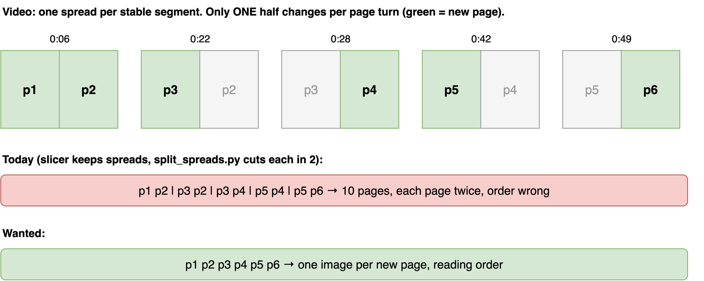
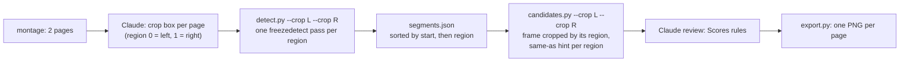

# Score videos with page regions, and .mkv input

Two requests:

1. The slicer must accept `.mkv` videos.
2. The slicer must handle score videos like `test-data/Metal_arranged_by_Sean_O_Loughlin-[oumRCgkJAIU].mkv` (AV1 in Matroska, 1280x720, 5:55). It shows two score pages side by side, and a page turn replaces only one page.

Skill at the start of this change: [`SKILL.md`](../../../.claude/skills/video-slicer/SKILL.md) at commit `81d82a7`.

## Findings

### .mkv already works

`samples.py`, `detect.py` and `candidates.py` ran on the Metal `.mkv` with no error. No script checks the file extension. Only the tests and the `SKILL.md` example use `.mp4`.

### Half-turn page pattern



Source: [`diagrams/half-turn.drawio`](diagrams/half-turn.drawio).

Measured on the 46 full-frame candidates (PSNR per half against the previous candidate):

- Each page turn changes exactly one half (about 15 dB). The other half stays the same (40 to 50 dB).
- The halves take turns: left, right, left, right.
- 10 candidates change in neither half (both halves above 39 dB). These are extra splits by `freezedetect`.
- The cover at 0:01 to 0:03 is one page in the centre of the frame.
- Each half has a page-curl animation of about 0.5 to 2 s, which `freezedetect` skips.

Per-half detection gives 30 segments for the left page and 48 for the right, for about 37 pages. So about 40 segments repeat a page that is already on screen.

With one crop box, every candidate is a spread. Cutting each spread into two pages gives every page twice, in the wrong order (p1 p2 p3 p2 p3 p4 ...).

## Target behaviour

One PNG per new page, in reading order. When the montage shows two pages side by side, Claude sets one crop box per page. Detection runs per page region. Each stable segment of a region is a page candidate, and the start time gives the reading order.



## Interfaces

### `detect.py`

- `--crop W:H:X:Y` can be given more than once. Region index = position of the crop on the command line, starting at 0.
- Each segment gets a `region` field. With one crop, every segment has `region: 0`.
- `segments.json` is sorted by `start`, then by `region`. When both pages change together, left comes first.

```json
[{"start": 5.8, "end": 21.6, "region": 0},
 {"start": 5.8, "end": 21.9, "region": 1},
 {"start": 22.1, "end": 42.0, "region": 0}]
```

### `candidates.py`

- `--crop` can be given more than once, in the same order as for `detect.py`.
- A segment with a `region` that has no crop is an error. A segment without `region` counts as region 0, so `segments.json` files from before this change still work.
- All crops must have the same `W:H`. Different sizes are an error.
- Each candidate in `candidates.json` gets `region`, `psnr` and `same_as`:
  - `psnr`: PSNR in dB against the previous candidate of the same region, or `null` for the first candidate of a region.
  - `same_as`: number of that previous candidate when `psnr` is at least `SAME_AS_MIN_DB = 40`, else `null`.
- Map line: the region is shown only when there are 2 or more crops. `same-as` is shown in every mode.

```
row 0 column 3: #4 00:00:28 region 1 same-as #2 (45 dB)
row 0 column 4: #5 00:00:42 region 0
```

### `export.py`

No change. It copies candidate PNGs, which are already cropped by region.

### `SKILL.md`

- Steps 1 and 2: if the montage shows two pages side by side, set one crop box per page, both the same size. Pass all boxes to steps 3 and 4.
- Step 5 gets a "Scores" subsection. Drop:
  - frames without a full score page, for example the cover cut in half
  - frames caught during the page-curl animation
  - `same-as` candidates, after a check
- The defaults name `.mkv` next to `.mp4`.

## Key Decisions

### Page logic lives in video-slicer

- **Decision:** The slicer gets page regions and writes one PNG per page.
- **Reason:** The user asked to extend the slicer for this kind of video. With spreads only, the slicer cannot give a correct result for half-turn videos.
- **Trade-offs:** Rejected: dedupe pages in music-transcriber after `split_spreads.py`, which leaves the slicer wrong for these videos. Rejected: a manifest of the changed half shared between the repos, which couples the two repos.

### Claude decides on score mode from the montage

- **Decision:** No flag. Two pages side by side in the montage means one crop box per page.
- **Reason:** Claude already reads the layout in step 1. Per-page regions also work when both pages turn together: both regions start a segment at the same time and the left page comes first.
- **Trade-offs:** Rejected: a `--score` flag, and automatic gutter detection in a script.

### Repeatable `--crop` with a region index

- **Decision:** `--crop` can be given more than once. Segments and candidates carry a `region` index. One crop works as before.
- **Reason:** This is the smallest change to the existing interface.
- **Trade-offs:** Rejected: named regions (`L=...`) and a separate `score.py` script.

### One freezedetect pass per region

- **Decision:** `detect.py` runs ffmpeg once per crop.
- **Reason:** One pass with `split` would mix the `freezedetect` log lines of the regions in stderr, and the parser could not tell them apart.
- **Trade-offs:** Runtime grows with the number of regions: about 6 s more for the Metal video, about 30 s more for a 44 min talk.

### Crop boxes must have equal size

- **Decision:** `candidates.py` rejects crops with different `W:H`.
- **Reason:** The contact sheet scales and tiles all frames, and `tile` needs frames of equal size. Two pages of one score have the same size.
- **Trade-offs:** A video with two regions of different size cannot use page regions.

### `same-as` hint, decision stays with Claude

- **Decision:** `candidates.py` prints a `same-as` hint at 40 dB or more against the previous candidate of the same region. Claude checks and decides.
- **Reason:** About 40 of 78 segments repeat a page, which is too many to compare by eye. 40 dB is the "same slide" value that `SKILL.md` already uses.
- **Trade-offs:** Rejected: automatic drop, since an extra note on an otherwise unchanged page can score close to 40 dB. The hint is also shown with one crop, which adds a suffix to today's map output.

### Cover cut in half is dropped

- **Decision:** Review drops the centred cover as "no full score page" and reports it.
- **Reason:** The cover holds the instrument list, not music.
- **Trade-offs:** Rejected: a third crop box for the cover.

### .mkv: test only

- **Decision:** No production code change. A test runs the scripts on an `.mkv` video, and `SKILL.md` names `.mkv`.
- **Reason:** The scripts already work on `.mkv`. A test keeps it that way.
- **Trade-offs:** Rejected: running every test on both `.mp4` and `.mkv`, which doubles the video fixtures for no extra coverage.

## Evaluation

There is no reference PDF for the Metal video. Check the kept pages against the page numbers printed on the score:

- every page appears once
- pages are in order
- no page is missing
- the cover is dropped and reported

Results go to `results/` in this folder.

## Out of scope

- music-transcriber: no change to its vendored slicer copy, its `youtube-input.md` brief or `split_spreads.py`.
- Scrolling or cursor-driven score videos.
